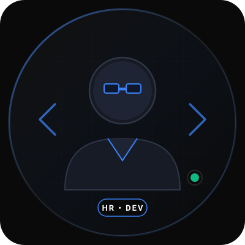

# Harsh Raghuwanshi — Professional Personal Portfolio

A sleek, modern, high-performance personal portfolio website built for **Harsh Raghuwanshi**, Aspiring Software Engineer, C++ Developer, and Problem Solver.

---

## 🎨 Design System & Theme

Designed according to an executive dark aesthetic:
- **Primary Background:** Pure Black (`#000000`) / Deep Dark (`#0A0A0A`)
- **Section Backgrounds:** Charcoal (`#111111`)
- **Primary Text:** Crisp White (`#FFFFFF`)
- **Secondary Text:** Light Gray (`#B3B3B3`)
- **Accent Color:** Subtle Electric Blue (`#3B82F6`)
- **Borders & Dividers:** Subtle Gray (`#262626`)
- **Typography:** `Inter` & `JetBrains Mono`

---

## 📂 Project Structure

```
portfolio/
├── index.html                           # Main portfolio single-page application
├── resume.pdf                           # Direct root resume PDF file
├── README.md                            # Documentation and deployment guide
├── css/
│   └── style.css                        # Complete responsive styles & dark theme tokens
├── js/
│   └── main.js                          # Navigation, scrollspy, modal, form & clipboard logic
└── assets/
    ├── images/
    │   ├── avatar-placeholder.svg       # Developer vector avatar with glowing ring
    │   └── README.txt                   # Instructions to swap with personal photograph
    └── resume/
        ├── Harsh_Raghuwanshi_Resume.html # Printable, responsive HTML resume
        └── Harsh_Raghuwanshi_Resume.pdf  # High-resolution PDF resume
```

---

## 🚀 Sections Included

1. **Sticky Navigation Bar:**
   - Brand monogram `[HR] HARSH RAGHUWANSHI`
   - Smooth navigation links: Home, About, Skills, Education, Projects, Experience, Certifications, Achievements, Contact
   - Instant "Resume" download button + "Preview" modal button
   - Mobile hamburger menu drawer with smooth toggle
2. **Hero Section:**
   - Headline: *"Hi, I'm Harsh Raghuwanshi"*
   - Subtitle: *"Aspiring Software Engineer | C++ Developer | Problem Solver"*
   - Two-column desktop / stacked mobile layout
   - Quick action CTAs ("View My Projects", "Download Resume", "Preview Resume", "Contact Me")
   - Social & professional channels (GitHub, LinkedIn, Email, Phone)
   - Professional avatar placeholder with active status badge
3. **About Me:**
   - Undergraduate Information Technology student at Bansal Institute of Science & Technology, Bhopal (2024–2028)
   - Official Career Objective quote box
   - Fast highlights: Current Education, CGPA (7.49 till 3rd sem), Core Languages (C & C++, Python), and Internships
4. **Technical Skills:**
   - Categorized cleanly into Programming Languages, Web Development, Databases, Core Computer Science, Developer Tools, and Soft Skills
   - Clean badges with SVG icons — *no artificial or deceptive progress percentage bars*
5. **Education:**
   - Bansal Institute of Science & Technology, Bhopal (B.Tech IT, 2024–2028, CGPA 7.49)
   - New Sarvodaya Higher Secondary School (Class XII MP Board, 2023–2024, 75.4%)
   - Jawahar Navodaya Vidyalaya (Class X MP Board, 2021–2022, 82.4%)
6. **Projects:**
   - *Staff Management System* (C++)
   - *Health Reminder Application* (Python)
   - *Alumni Record Management System* (Database & Management)
   - Direct link to Harsh's official GitHub profile (`https://github.com/harsh-raghu-24`)
7. **Internship & Experience:**
   - *Code Alpha* (C++ Virtual Internship, 1 month)
   - *NASSCOM • HCLTech* (Artificial Intelligence Domain)
8. **Certifications:**
   - C++ Certification (Udemy, Nov 2024)
   - C Certification (Simplilearn, Oct 2024)
   - OCI Certification (Oracle, Nov 2025)
   - Fundamentals of Object-Oriented Programming (2026)
   - CS50’s Introduction to Programming with Python (Sep 2026)
9. **Achievements:**
   - Tech Escape Room Runner-up
   - Debugging Competition Runner-Up
10. **Contact Section:**
    - Quick contact cards with 1-click **Copy to Clipboard** for Email (`harshraghu83552@gmail.com`) and Phone (`+91-9584865269`)
    - Direct LinkedIn and GitHub profile links
    - Interactive message form that drafts directly to email
11. **Resume Modal:**
    - Interactive in-browser resume viewer with options to print or download the PDF.

---

## 💻 How to View & Run Locally

### Option A: Double-Click
Simply open `index.html` in any web browser (Chrome, Edge, Firefox, Brave, Safari).

### Option B: Local Development Server
From this directory, run:
```bash
# Using Python
python -m http.server 3000

# Or using Node.js
npx serve
```
Then visit `http://localhost:3000`.

---

## 📸 How to Add Your Own Photograph

1. Place your photo (e.g. `profile.jpg` or `profile.png`) in `assets/images/`.
2. In `index.html`, locate line 155:
   ```html
   
   ```
3. Change `src` to `assets/images/profile.jpg`:
   ```html
   
   ```

---

## 🌐 How to Deploy to GitHub Pages (Free)

1. Create a repository on GitHub (e.g. `harsh-raghu-24.github.io` or `portfolio`).
2. Push this folder's contents:
   ```bash
   git init
   git add .
   git commit -m "Initial commit of portfolio website"
   git branch -M main
   git remote add origin https://github.com/harsh-raghu-24/portfolio.git
   git push -u origin main
   ```
3. Go to **Settings > Pages** in your GitHub repository and select **main branch / root**.
4. Your site will immediately be live at `https://harsh-raghu-24.github.io/portfolio`!
